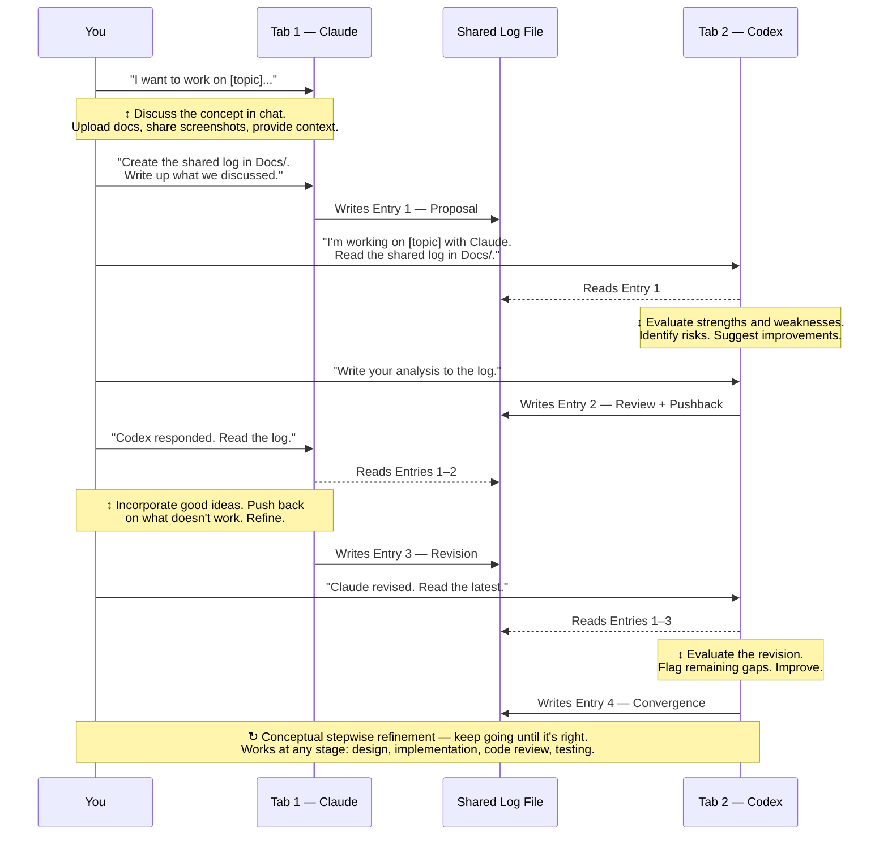

# Two Tabs and a Log File

*The simplest way to get two AI agents collaborating — no infrastructure, no configuration, no workflow documents*

David Todd · March 2026 · LexiWord Project

---

## A Note from the Author

This is a companion to my longer article, "I Learned a Valuable Lesson. I Don't Think You've Learned Anything," which covers my full experience learning to work with two AI coding agents over five weeks. That article describes a formal two-agent consensus workflow with finite state machines, polling mechanisms, and structured handoff protocols. It works well. It also took weeks to build.

This article is about what came before all of that — the version that takes five minutes and requires nothing you don't already have.

If you're using two AI coding agents and you've never had them work on the same problem together, start here. You don't need workflow documents. You don't need configuration files. You don't need to understand finite state machines or polling or structured handoffs. You need two terminal or browser tabs and one shared file. That's it.

I want to be clear about what this is: a technique, not a product. There's nothing to install. There's nothing to configure. You're going to open two windows, create a file, and start talking. The technique is how you use that file to get two agents building on each other's thinking instead of working in isolation.

One thing to know up front: this technique works with any two AI agents, but it's easiest with agents that live in your project and can read and write files directly. I use Claude Code (Anthropic's CLI agent) and Codex (OpenAI's). For readability, I'll just say Claude and Codex from here on. Both operate directly in my codebase — they read files, write files, create folders, and execute commands in the project directory. That means both agents write to the shared log and read from it directly, without me doing anything. If you're using agents that can't do that — browser-based chat interfaces, for instance — the technique still works, but you become the courier. You copy each agent's output and paste it into the shared file, or paste it into the other agent's window. It's more manual, but the core value is the same: two agents refining the same concept, each responding to what the other actually said.

You don't need to read the main article first. This one stands on its own. But if you try this and want to see what it can produce, the companion article "Two Agents, One Memory" describes a shared persistent memory system that was designed, negotiated, and built entirely using this technique — in a single day. That system gives both agents the same startup context every session: shared rules, session history, and a task queue, all in one location. No more manually relaying context between windows. No more duplicated rules drifting out of sync. It's the most immediately useful thing that came out of my five weeks with these tools, and it started with nothing more than a shared log file and two tabs. If you want to go further and formalize the back-and-forth — automate it, add structure, handle complex multi-phase work — that's what the main article covers.

— David Todd
March 2026

---

## The Problem

If you're working with two AI coding agents, you're probably using them separately. Maybe you use one for design conversations and the other for implementation. Maybe you switch between them depending on the task. Either way, each agent works in its own window, in its own context, with no awareness of what the other one is doing.

That means insights from one agent never reach the other unless you manually relay them. You have a design conversation with Claude, work through a tricky architectural decision, arrive at something solid — and then you switch to Codex and have to re-explain the whole thing from scratch. Or worse, you don't re-explain it, and Codex makes decisions that contradict what you just agreed on with Claude.

You're the bridge between them. Every piece of context, every decision, every constraint — it all flows through you. That works when the task is simple. When the task is complex, you become the bottleneck. You forget things. You summarize imperfectly. You leave out the detail that turns out to matter.

There's a better way, and it doesn't require any infrastructure at all.

---

## How This Started

I didn't set out to invent a collaboration technique. I was trying to solve a specific problem — designing a shared memory system for my two agents — and I needed both of their perspectives.

Claude is good at architecture and design thinking. Codex is good at implementation concerns and catching things that look right on paper but break in practice. I wanted both of those perspectives applied to the same problem, and I didn't want to be the one translating between them. I wanted them responding directly to each other's analysis.

So I created a shared file in my project's documentation folder. I told Claude to write its proposal there. I switched to Codex's window and told it to read what Claude wrote and respond in the same file. Then I went back to Claude and told it to read what Codex wrote and revise.

That was it. That was the whole technique. And the result — a shared memory system designed, negotiated, revised, and converged on by two agents over the course of a day — was better than what either agent would have produced alone. The specific disagreements between them shaped the final design in ways I wouldn't have anticipated if I'd worked with just one.

I realized afterward that the technique itself was worth writing up separately, because the value isn't specific to memory systems. It works for any problem where you want two perspectives applied to the same concept.

---

## The Technique

Here's the whole thing at a glance — what you say in each window and how the log file connects them:

*Figure 1: The complete flow. You direct each agent in its own tab. The shared log file carries the context between them. Repeat until the concept converges.*

### Pick a Shared Location

Before you start, decide where the shared file will live. You want a consistent directory for collaborative work — not files scattered across your project. I use my project's documentation folder (`LexiWord-Docs/`), which I created on day one. You might call yours `Docs/`, `Collaboration/`, `SharedWork/` — whatever makes sense for your setup. The point is: both agents know where to find it, and you're not hunting for files later.

### Start with Your Design Agent

Open your first agent's window. For me, this is Claude, because I use Claude for design work and high-level reasoning, but use whichever agent you prefer for the thinking-and-discussing phase. Tell it something like:

> "I want to work on [topic]. I'm going to share this with Codex so we can collaborate on it..."

Then have a conversation. Talk through your concept, your goals, the problems you're trying to solve. This is your normal design discussion — the same thing you'd do if you were only using one agent. Go back and forth in the chat. React to what the agent says. Add your own ideas. Push back on things that don't sound right. Upload documents, provide screenshots, share whatever context the agent needs to understand the problem. This is where the thinking happens.

When you're satisfied with where the conversation has landed, tell Claude to create the shared log file and write it up:

> "Create a shared log file in [your docs folder]. Write up what we just discussed — I'm going to share this with Codex for review."

The agent creates the file, writes its proposal, and now there's something concrete for the other agent to respond to.

### Switch to Your Implementation Agent

Open your second agent's window. Tell it something like:

> "I'm working on [topic] with Claude. There's a shared log in [your docs folder] — go read what Claude wrote and tell me what you think."

Codex reads the log, sees Claude's proposal, and shares its reaction with you in the chat. Now you have a conversation in Codex's window about it. Tell it what you want: evaluate the strengths and weaknesses, identify risks, suggest improvements, flag things that won't work in practice. You can upload additional context — documents, screenshots, whatever helps the agent understand the problem better. You can guide its focus — "I think the FSM might be overkill, what do you think?" — or let it react on its own. The point is that the agent isn't just reading and acknowledging — it's actively looking for ways to make the proposal better. Then when you're ready:

> "Write your analysis to the log."

Codex appends its response to the shared file. The key detail: Codex is responding to what Claude actually wrote, not to your summary of what Claude said. That's the difference between this and manually relaying information.

### Go Back to the First Agent

Switch back to Claude's window. Tell it:

> "Codex has responded in the shared log. Read what Codex wrote."

Claude reads Codex's entry and shares its reaction with you. Same job as before but in reverse — evaluate Codex's concerns, incorporate what makes sense, push back on what doesn't, suggest improvements to the parts that are close but not right. You discuss it — "that's a fair point about collision risk" or "I don't think that applies here because..." — and when you're ready, Claude writes its revised position to the file. Same pattern every time: read, evaluate, discuss, write.

### Repeat Until You're Satisfied

This is conceptual stepwise refinement. Each round, both agents are working to improve the same concept — evaluating strengths and weaknesses, identifying risks, suggesting improvements, incorporating the other agent's good ideas, pushing back on the bad ones. With each pass, the concept gets tighter. Gaps get filled. Weak points get addressed. The thinking converges.

Keep switching between windows. Each round follows the same rhythm: the agent reads what the other wrote, evaluates it, you discuss it in the chat, you give your input, and the agent writes its refined thinking to the shared file. The log file accumulates both perspectives in one place and shows the full arc of how the concept evolved.

This works at any stage of development — design, implementation, code review, test planning, debugging strategy. Any problem that benefits from two perspectives and a written record of how the thinking was refined. You can do as many rounds as the task needs. Simple topics might converge in two or three rounds. Complex designs might take ten or more. You decide when it's done.

### What You End Up With

A single document containing the structured thinking of two different AI agents, each responding to the other's analysis, with you directing every step. The document is the deliverable — it's the design, the analysis, the decision record. You didn't have to write it. You just had to think about it and talk about it, and the agents did the documentation.

---

## A Real Example

The Shared Memory Collaboration Log included in the GitHub repository is exactly this technique in action.

I needed to unify two separate memory systems — Claude's and Codex's — into a single shared architecture. The problem was complex enough that neither agent alone would have caught everything. So I created a log file and started the back-and-forth.

Codex opened with a structured proposal: three content layers and a nine-state finite state machine to enforce agent behavior. Claude pushed back — the FSM was over-engineering for a memory system that doesn't involve the multi-pass handoffs where compliance had actually broken down. Claude also flagged a collision risk in Codex's proposed snapshot file.

The session model changed three times in a single day. Codex proposed a monolithic snapshot. I suggested a capped rolling log as a compromise. Codex raised collision concerns about even append-only shared files, and we landed on individual files — each agent writes its own, nobody touches anyone else's. That turned out to be the right answer, and it came from the friction between the two proposals.

The FSM came back, too. After Claude argued against it and I initially agreed, I reconsidered based on direct experience — agents had rationalized away from rules in other workflows when there wasn't structural enforcement. Claude acknowledged this honestly, citing the consensus workflow document that exists at 335 lines because lighter-touch instructions had failed. The compromise was a compact FSM focused specifically on memory operations — enough structure to prevent drift, without the weight of the full consensus machinery.

Even the timestamp format in the final design came from a specific failure that surfaced during the collaboration — Codex had been writing timestamps two hours off from my local time, breaking cross-agent ordering. The fix: encode Pacific time in the filename itself. Simple, deterministic, born from a real problem that neither agent would have surfaced working alone.

The resulting log shows structured entries from both agents: proposals, revisions, pushbacks, risk analysis, and convergence toward a working design. It runs to over 1,700 lines. The system it produced — a shared memory architecture I now use every day — was designed, negotiated, built, and migrated in a single day.

All of that came from one shared file and two tabs.

---

## Why This Works

There's no magic here. The technique is simplest when both agents live in your project directory and can read and write files directly — Claude and Codex are CLI agents that operate in your codebase, so when you tell Claude to create a log file, it creates an actual file in your project folder, and when you tell Codex to read it, it reads it directly. No copying, no pasting. But even if your agents can't do that, you can be the courier — copying content between windows and the shared file. Either way, you're giving them a place to put their thinking where the other agent can see it.

You're the relay and the decision-maker. You switch between windows. You decide what to discuss with each agent. You decide when to guide the conversation and when to let the agent respond directly to what it read. You decide when it's done. The agents don't coordinate with each other — they coordinate through you, and the shared file is how the context transfers.

The technique isn't limited to design work. I've described a design example because that's where I started, but the same approach works at any stage of development — implementation planning, code review, debugging strategy, test planning, architecture decisions. It's conceptual stepwise refinement. Each round, both agents evaluate the current state of the concept, identify what's strong and what's weak, suggest improvements, and the concept gets tighter. The shared log captures that entire arc — the evaluation, the risk analysis, the pushbacks, and the convergence. That's useful regardless of what the topic is.

The log file captures both perspectives in one place. That matters more than it sounds like it should. When two agents work separately, their insights live in two different chat histories that you have to hold in your head simultaneously. When they write to the same file, you have one document with the full arc of the discussion. That document becomes the deliverable.

And the agents respond to each other naturally. When Codex reads Claude's proposal and writes a pushback, it's doing what it does well — analyzing something and finding the gaps. When Claude reads the pushback and revises, it's doing what it does well — synthesizing feedback and improving the position. You're leveraging what each agent is good at, directed at the same problem. I think that's incredibly powerful, and I don't think most people using two agents have tried it.

---

## Limitations

I want to be honest about what this doesn't do.

This is manual relay. You're doing all the switching. Every time you want one agent to see what the other wrote, you have to open that agent's window and tell it to go read the file. There is no automation. If you forget to tell one agent to read the latest entry, it works from stale information and you might not notice until the analysis doesn't make sense.

There's no structured handoff protocol. The agents don't know when the other agent has written something. They don't know it's their turn. They don't know the collaboration is happening at all unless you tell them. You are the entire coordination layer.

For simple tasks — a design question, an architecture decision, a code review, an implementation plan — this is fine. The manual overhead is small relative to the value. For complex multi-phase work that spans design through implementation through testing, with dozens of handoffs and multiple documents, the manual approach gets tedious and error-prone. You start forgetting which agent has the latest context. You start losing track of what was decided versus what was proposed. The overhead that was manageable for a focused design session becomes a drag on a multi-day effort.

That's exactly what motivated the formal workflow documents described in the main article — the consensus workflow, the agent collaboration spec, the polling mechanisms and finite state machines and structured handoffs. Those exist because this simple version, as effective as it is for focused work, doesn't scale to sustained complex collaboration without you becoming the weakest link in the process.

But you don't need any of that to start. Start here. See what two agents produce when they can respond to each other's thinking. If the value is obvious — and I think it will be — you'll know when the manual approach isn't enough, and the formal workflows will make a lot more sense when you get to them.

---

## Where to Go Next

If you found this useful and want to go further, the two companion articles pick up where this one leaves off.

**Two Agents, One Memory** describes the shared persistent memory system I built using exactly this technique. It's both a worked example of the collaboration approach and a practical system you can set up in five minutes with a bootstrap kit. If the collaboration log convinced you that two agents produce better designs than one, the memory article shows you how to make sure both agents start every session with the same context — rules, session history, and task queue — without you having to relay anything.

**I Learned a Valuable Lesson. I Don't Think You've Learned Anything.** is the full story — the five-week learning curve, the formal two-agent consensus workflow, the agent collaboration spec, and everything I've figured out (and haven't figured out) about working with AI coding tools. It's long, it's detailed, and it covers everything from debugging strategy to workflow documents as programs. If you want the complete picture, that's where it lives.

All three articles release together in the same GitHub repository.

---

## Resources

All files referenced in this article are available in the GitHub repository:

**Repository:** `github.com/TheGameWiz/Measure-Twice-Cut-Once`

| File | Description |
|------|-------------|
| [`Examples/Shared-Memory-Collaboration-Log.md`](../Examples/Shared-Memory-Collaboration-Log.md) | The actual design conversation between Claude and Codex — proposals, pushbacks, revisions, and convergence. A real-world example of the technique described in this article. |

### Companion Articles

| Article | Description |
|---------|-------------|
| [I Learned a Valuable Lesson. I Don't Think You've Learned Anything.](./I-Learned-a-Valuable-Lesson.md) | The full story — learning curve, two-agent workflow, consensus process, and everything that led here |
| [Two Agents, One Memory](./Two-Agents-One-Memory.md) | Companion article: unifying two agents' separate memory systems into a single shared architecture — designed using the technique described in this article |

---

## Important Notice

The observations and opinions in this article are strictly my own, based on approximately five weeks of personal experience with AI coding tools on a single project. They are not intended as a thorough evaluation of Claude Code, Codex, or any other product, and they don't represent the views of Anthropic, OpenAI, or any other company. Where I describe one agent as better or worse at a particular task, that reflects my experience in my specific context — game development in Unity 6.2 — and may not apply to yours. I'm not endorsing or disparaging any product. I use both tools daily and find genuine value in each.

The technique described here involves AI agents reading and writing files in your project directory. You should satisfy yourself that any instructions you give to an agent are appropriate for your environment. I am not responsible for any damage, data loss, or unexpected behavior that results from using these materials. Use them at your own risk.

---

## Copyright and License

Copyright (c) 2026 David Todd.

This article is licensed under the **Creative Commons Attribution-ShareAlike 4.0 International (CC BY-SA 4.0)**.

See [LICENSE](../LICENSE) and [NOTICE](../NOTICE) for attribution guidance and terms.
